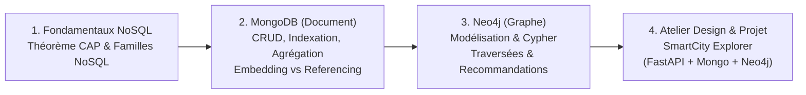

# 🍃 Bases de Données NoSQL — ESIGELEC (Dominante BDTN)

Bienvenue sur l'espace GitHub du module **Bases de Données NoSQL** (20h) de l'**ESIGELEC Rouen** (Dominante *Big Data pour la Transformation Numérique — BDTN*).

---

## 📚 Dépôts de Référence du Cours

| Dépôt | Rôle | Accès |
| :--- | :--- | :--- |
| **[`nosql-esigelec/course`](https://github.com/nosql-esigelec/course)** | **Hub du Cours & TDs** : Support de cours Slidev, [Guide de l'Étudiant](https://github.com/nosql-esigelec/course/blob/main/GUIDE-ETUDIANT.md), [Aide-Mémoire](https://github.com/nosql-esigelec/course/blob/main/AIDE-MEMOIRE.md), Atelier de Design d'Architecture et Notebooks Jupyter (`MongoDB` & `Neo4j`) sous Docker. | Public |
| **`nosql-esigelec/smartcity`** | **Projet Fil Rouge — SmartCity Explorer (Édition 100% NoSQL)** : Application FastAPI + Streamlit exploitant **MongoDB** (*Embedding* Villes/Scores & *Referencing* Avis) et **Neo4j** (Graphe de similarité & Recommandations) en 4 Sprints. | Template Privé (Équipes) |

---

## 🗺️ Parcours Pédagogique

---

## 🛠️ Stack Technique du Module

- **Bases de données NoSQL** : MongoDB 7 (Motor / PyMongo) · Neo4j 5 (Cypher / Driver Python officiel)
- **Backend & Frontend** : Python 3.11+ · FastAPI · Pydantic · Streamlit · Jupyter Lab
- **Outillage & DevOps** : Docker Compose · `uv` · `just` · Pytest · GitHub Actions (Évaluation continue par Sprint)

---
*Intervenant : **Brice Fotzo** — Tech Lead Data & MongoDB User Group Leader Paris*
